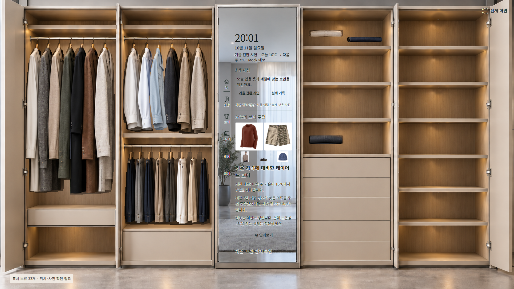
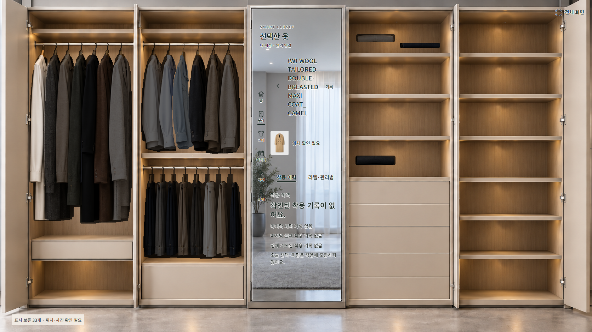

# P3–P10 재개 결과

2026-10-11 · `feat/handoff-p3-p10` · 재개 기준 `3bb02e6`.

**전체 판정: PARTIAL.** 승인 에셋24개를 실제 격리 DB·Scene API·앱에 연결했고, 두 시연 계정의 서버 추천·Mock VTON·코디 확정·LED·카드 저장을 검증했다. T1–T4 원본 접힘/가림 복원과 기존 데이터 회수 후 옷장 표시가 미완료다. 저장 성공으로 시각 품질을 완료 처리하지 않는다.

이번 재개 지시, `05_P3_P10_REMEDIATION.md`, G1 및 이후 승인을 적용했다. B3는 승인된 v8 그대로 사용했다. 별도 옷장 시안·검수 페이지·파이프라인을 만들지 않았다. 로컬 브랜치와 `wardrobe_test_remediation`에서만 작업했다. 운영 DB, 원격 push/merge/배포, 유료 Decart, 실물 제어는 수행하지 않았다.

## 계약별 현재 상태

| 범위 | 판정 | 근거와 남은 조건 |
|---|---|---|
| P3 승인 에셋·DB 연결 | PASS, 승인된 범위 | 행거21/선반 K1–K3 3개, 원본/파생 asset 분리, SHA256, 동의·업로드·finalize·등록, 재실행 중복 없음. 미확정 선반 상품은 미등록 |
| P4 동적 화면·찾기 | PASS, 승인된 범위 | Scene24개 실제 decode. 선택 밝기1/비선택.4, 배경 필터·사각 LED 없음, 자동 소등. 외부 이동→사라짐→복귀 검증 |
| P4 코디 확정 | PASS, Mock | 서버 추천의 확인된 실제 슬롯 다중 점등. 불확실/미매핑 409 차단. OUTFIT_SELECTION만 추가, 실제 WEAR0. 실물 게이트는 별도 |
| P7 Gate A | PARTIAL | 네 독립 레이아웃·원본/복원/바닥 비교 확보. 개별 원본 접힘·가림 레이어의 충실한 재구성 미완료 |
| P7 Gate B | PARTIAL | 실제 DB 선택 사진·SVG 마스크·foreground crop. 흰 C6 바지 원단 손실 수정. 소매 접힘·부피·가림·광원 정합성 미완료 |
| P7 Gate C | PASS, 로컬 | 두 계정 각각 네 종류, 총8개 신규 PNG→private MinIO→DB→재조회/다운로드. Gate A/B 통과를 뜻하지 않음 |
| P5/P8/P9 통합 | PARTIAL | 두 프로필 전환/조회/찾기/추천/Mock VTON/복귀/확정/카드 저장 및 승인 외투 보관·회수 DB/화면 PASS. 기존 비승인 데이터 회수 화면 표시만 미완료 |
| P10 계약 검사 | PASS | FSD 추적, 기존 통합 경로/DTO 문서화, 1.7 개정 provenance, 계약11 PASS. 이는 문서/스키마 계약 검사 통과이며 제품 전체 완료는 잔여 Gate 해결 후 가능 |

## 데이터·표시 범위

기존52 + 승인24 = **총76개**이며 최종 의류76개 각각에 상품 원본 사진이 연결되어 있다. 승인24개는 의류1개당 장면 PNG1개인 일대일 매핑(행거21/선반3)이다. 가족4인 모델을 유지한다. 현재 소유 수량은 김수진20/최휘재43/아빠9/딸4다. 소유·위치·상태는 G1 합성 시연 맥락이며 실제 구매/착용 기록이 아니다. 새 의류 UNKNOWN 상태는 위치 관측과 구분하여 합성 AVAILABLE로 한 번 초기화한다. 재실행은 이후 상태를 초기화하지 않는다.

provisioning 전후 기존52의 의류 ID·소유자·원본 asset ID·위치·상태 snapshot은 동일했다. **이후 계절 QA는 기존 일부 의류를 API로 이동했다.** 전체 세션 동안 기존 상태가 불변이었다고 주장하지 않는다.

이전 시안 슬롯의 `scene_visibility=hidden`은 **표시 변경**이다. 의류 삭제/조회 제외가 아니다. 최종 화면은 승인21행거/3선반24개다. 최종 집계 내부56=승인24+숨김 기존32이며, 나머지20=외부11+소품 서랍8+신발1이다. 총76 또는 내부56개가 모두 표시된 것은 아니다. CSV의 captured_at은 2026-10-11T11:15:25Z이며 이후 변동은 실제 DB 조회를 따른다. 이전 시안 숨김 슬롯은 `SLOT_UNAPPROVED` 표시 보류로 알리고 실제 외부 상자/닫힌 서랍과 구분한다. 미확정 선반 상품/위치를 임의 등록하지 않았다.

정본 매핑: [approved_scene_manifest.json](../templates/approved_scene_manifest.json). 실제76개 현재 DB 위치/상태: [live-data-mapping.csv](evidence/remediation/live-data-mapping.csv). 수량·원본 해시·MinIO 다운로드: [data-integrity.json](evidence/remediation/data-integrity.json). manifest 위치는 승인 초기 배치이며 **현재 위치 정본은 PostgreSQL/Scene API**다. 보관·회수 테스트는 UI 승인에 따라 실제 로컬 DB 위치를 변경한 것이며 물리 의류 이동과 LED 출력은 시뮬레이션이다.

B3 및 승인 PNG 해시와 원본 상품 사진을 보존했다. K1–K3는 승인 샘플의 기존 좌표를 기존 native Canvas exporter에서 추출했다. 원본 사진과 별도 OTHER scene asset을 기존 JSON metadata로 연결했다. DB 컬럼/Migration은 추가하지 않았다. 신규 등록은 고정 Idempotency-Key와 원본 업로드 재사용을 적용했다. `product_reference.status/ownership_basis`는 최초 후보 문서의 출처 속성이며 현재 적재 여부는 manifest mapping과 DB 의류 ID로 판단한다.

## 수정한 결함

- 로컬 데모 JWT에 HOME station이 없어 LED403이었다. 명시적 `LOCAL_DEMO_STATION_ID`를 비공개 로컬 시연에서만 회원의 연결된 HOME station으로 검증한다. STORE/public 거부 회귀도 확인했다. 공개 장치 인증을 우회하지 않았다.
- 목록 갱신이 Scene 파생 캐시를 삭제하여 확정 후 옷이 사라졌다. Scene binding을 실제 의류 ID에 연결하고 frame을 의류 reconcile에서 제외했다. 의류 삭제·로그아웃 캐시/Object URL 정리는 유지한다. cache unit과 실제 확정 회귀로 확인했다.
- 이전 브라우저 검증은 표시용 겨울 시연 추천을 사용했다. 이제 실제 기록→서버 추천을 호출하고 승인된 DB 의류 ID를 검사한다. HANDOFF scene 모드에서만 현재 승인 표시 의류를 추천 constraints로 전달한다.
- 흰 C6의 자동 배경 제거가 원단을 손상했다. 원본450×600에서 확인한 외곽을 SVG scanline으로 지정했다. 원본 래스터는 수정하지 않았다.
- renderer는 SVG 내부 사진 decode를 확인하고, 독립 레이아웃을 유지하며 외부 사진 여백만 제외한다.
- `storage-greedy-v3`는 픽셀별 승인 에셋의 회수 목적지를 해당 `approved_instance_id`의 승인 슬롯으로 제한한다. 다른 승인 칸·이전 시안 칸에 끼워 넣지 않는다. 외부 상자는 허용하며 완료 시 기존 용량·관측·동시성 재검사는 유지한다. 슬롯 metadata만 보완했고 신규 DB 필수 필드는 없다. 승인 외투의 WINTER 태그는 명시적 G1 합성 시연 분류로 한 번 초기화하고 이후 편집을 덮어쓰지 않는다.

기존 imagegen 방식으로 [K2/T1 접힘 파생 후보](evidence/remediation/K2-T1-styled-candidate.png)를 한 번 제작했다. 접힘은 개선됐으나 원본 라벨·디테일 보존을 인증하지 못해 **증적 전용으로 보관하고 앱·DB에 연결하지 않았다.** Gate B 성공이 아니다.

## 검증 결과

| 검증 | 결과 |
|---|---|
| backend unit/실DB integration/E2E | 최종284 PASS/실패0, 144.88초. 마지막 metadata 형태 방어 변경 후 보관 unit23 재실행 PASS (284에 포함된 같은23개이며 합산하지 않음) |
| 계약·공식 OpenAPI validator·생성 API 대조 | 11 PASS |
| web unit/cache/scene geometry | 39 PASS |
| TypeScript/production build | PASS, 기존 큰 chunk 경고 |
| renderer | 6 PASS |
| 엄마→아들→엄마 시연 프로필 | PASS, 각각76개/원본사진76/소유자4인 |
| 승인 scene·찾기·외부 이동/복귀 | PASS, visible24=derived24, 행거21/선반3, page error0 |
| 양 계정 서버추천→Mock VTON→확정→카드4종 | PASS, 신규 PNG8개, 실제 WEAR0 |
| 양 계정 승인 외투 보관/회수 | PASS, 합성 SUMMER 보관 컨텍스트→UI 승인·완료→겨울 회수 버튼→본래 DB 슬롯·화면 복원 |
| 기존 겨울 회수 DB→scene | PARTIAL_LEGACY_ASSET_MAPPING_PENDING; browser 전체 exit1 |

[검증 집계](evidence/remediation/verification-results.json), [백엔드 로그](evidence/remediation/backend-regression.log), [최종 browser.json](evidence/remediation/browser.json)을 따른다. 브라우저21개 체크는20 PASS/1 PARTIAL이며 page error 및 실패 HTTP 응답은0이다. 기존 browser-failure.json/failure.png는 수정 전 실패 증적이다. 공유 renderer를 backend와 브라우저가 동시에 사용한 실행에서는 T2가 QUEUED여서282 PASS/1 FAIL이었다. 동시 실행에 따른 자원 경합을 원인으로 추정하여 직렬 재실행했으며 테스트를 제외하지 않았다. 캐시/마스크/station 코드 결함과 구분한다.





기존 비교 증적 갱신: [T1](evidence/remediation/T1-comparison.png), [T2](evidence/remediation/T2-comparison.png), [T3](evidence/remediation/T3-comparison.png), [T4](evidence/remediation/T4-comparison.png). 실제 네 출력물을 시각 검사했으며 PNG 저장 성공과 접힘/가림 실패를 분리한다.

## 계약·파일·재현

기존 DB·필수 필드·API 동작은 유지한다. OpenAPI에 이미 구현된 통합 경로13개/요청 schema5개를 문서화하고 기존 FSD ID를 연결했다. `CONTRACT_REVISION_1_7.json` amendment는 이전 해시와 변경 FSD/OpenAPI 해시·근거 커밋·승인 이유를 기록한다. 1.1–1.6 아카이브/DB baseline 및 다른 설계 문서는 수정하지 않았다.

주요 변경은 기존 exporter/provision/local/evidence 스크립트, approved-v1 PNG24개/manifest, WardrobeSceneLayers/imageBlobCache/homeServerActions, backend integration/shopping/scene/config, renderer layouts/server, 관련 테스트/계약/보고서다. 구현 로컬 커밋은 `c9dd6ac`이며 재개 상태는 [REMEDIATION_CHECKPOINT.md](REMEDIATION_CHECKPOINT.md)에 기록했고 보고·증적 커밋은 로컬 Git log로 확인한다.

현재 앱: http://127.0.0.1:5193 . 마이→‘누가 옷장을 사용하나요?’→김수진/최휘재. 홈→실제 기록→내 옷 추천 받기. 서비스별 별도 창에서 실행하며 이미 실행 중인 포트에 중복 기동하지 않는다.

```powershell
# 루트, 기존 격리 컨테이너와 gitignore runtime 필요
.\.venv\Scripts\python.exe scripts/remediation_local.py serve
.\.venv\Scripts\python.exe scripts/provision_wardrobe_sprites.py --approved
# renderer 창
cd renderer
$env:RENDERER_PORT='3300'; $env:RENDERER_BIND_HOST='127.0.0.1'
npm start
# web 창
cd web
$env:WEB_PORT='5193'; $env:WEB_API_TARGET='http://127.0.0.1:18081'
$env:WEB_STORAGE_TARGET='http://127.0.0.1:19000'; $env:VITE_HANDOFF_SCENE='on'
npm run dev
```

검증은 공유 renderer/LED 경합을 피하도록 **직렬** 실행한다. 루트 `python scripts/handoff_checks.py`, web `node test/demo-personas-browser.mjs`, `node test/wardrobe-sprites-browser.mjs`, `node test/remediation-browser.mjs`. 마지막은 현재 회수 표시 미완료로 exit1이다. 새 clone은 원본 인계 패키지의 `references/`, `contracts/`, `execution/` 및 `test-results/handoff/runtime.json`, `test-results/remediation/source-images/`를 별도로 준비해야 한다. 현재 실행 명령은 준비된 격리 DB 환경용이며 빈 clone의 자동 구축을 보장하지 않는다. 비밀번호/토큰/서명 URL은 Git/보고서에 넣지 않는다.

## 실패 항목 분류

| 분류 | 항목 | 처리 |
|---|---|---|
| 코드 결함, 수정 완료 | 로컬 station 누락403, Scene 캐시 삭제, C6 원단 마스크 손실, SVG decode 누락 | 최소 변경 및 해당 회귀 PASS |
| 환경 제약, 원인 추정 | 공유 renderer 동시 부하 시 QUEUED/테스트 실패 | 직렬 재실행284 PASS. 원인을 확정한 것으로 주장하지 않음 |
| 설계·승인 매핑 충돌, 미완료 | 기존52의 이전 시안 슬롯과 승인된 새 장면 간 매핑 | 비승인 슬롯은 명시적 보류; 임의 에셋/슬롯 대입 금지 |
| 시각 구현 결함, 미완료 | T1–T4 접힘/가림·빛과 실제 사진 치환 | Gate A/B PARTIAL, PNG 저장 통과와 분리 |

## 남은 작업과 완료 기준

1. **P4/P8/P9 내부 미완료:** 승인 의류의 양 계정 계절 왕복은 검증했다. 남은 것은 기존52 중 현재 내부 숨김32품목의 승인 시각 매핑이다. 외부·닫힌 서랍의 의도적 비표시는 별도다. 미승인 상품/위치를 만들거나 이전 비승인 에셋을 자동 복원하지 않는다.
2. **P7 내부 미완료:** 원본별 개별 레이어·접힘·가림 복원 및 선택 품목 retargeting을 완성한다. 현재 affine/SVG/생성 후보로는 Gate A/B를 충족하지 못한다. 외부 장애로 위장하지 않는다.
3. **별도 외부 게이트:** 실제 Decart 비용·인증 승인, 실물 LED/센서/실측, 사진 공개·상업 사용 권리. Mock으로 대체하지 않는다. 기존 로컬 MinIO의 운영 보안을 인증하지 않았다.

잔여 Gate A/B와 기존 데이터의 시각 매핑을 해결하기 전에는 **전체 완료를 선언하지 않는다.**
