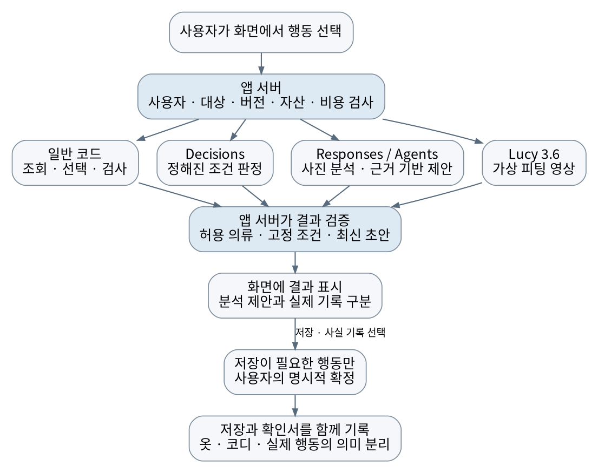
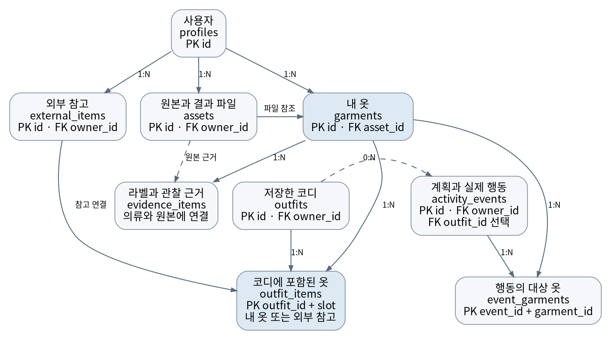
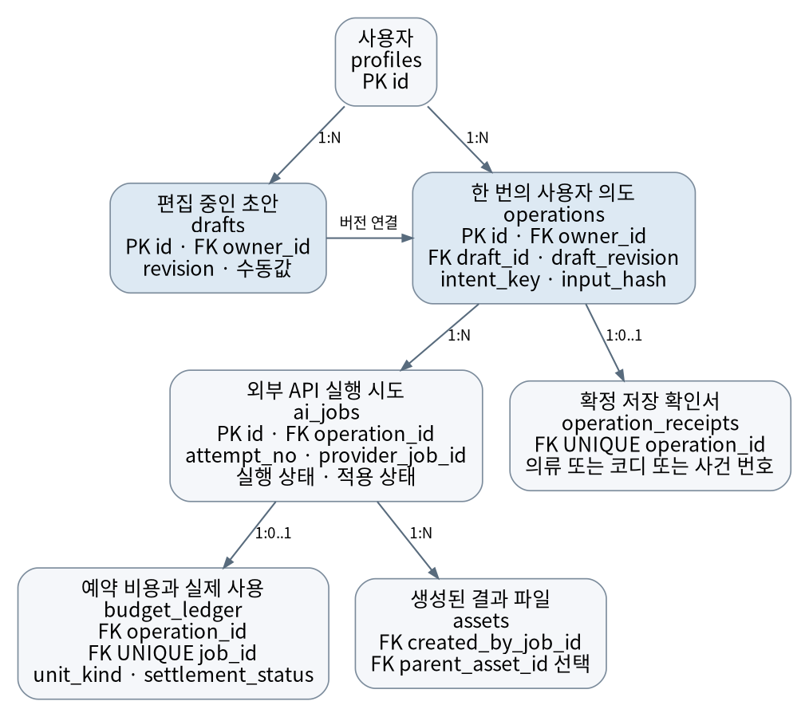

# 스마트 옷장 통합 설계서

2026년 10월 8일 · 최휘재 및 팀 검토용 · 통합 기준안 · 구현 승인 전

이번 검토에서는 최신 화면에 맞춰 연결할 기능, Agents API와 Decisions와 Lucy가 맡을 일, 사용자가 확정할 때 저장되는 기록을 결정한다. 화면에서 시작해 처리와 저장까지 이어지는 설계로 정리했다.

최신 첨부 화면이 최상위 기준이다. 현재 원본 화면의 픽셀 대조는 보류 중이며 2장에 표시했다. 기술 선택과 시연 범위의 미결정 항목은 8장에서 확인한다. 앱 구현과 실제 API 호출, 데이터베이스 변경, 배포는 진행하지 않았으며 구현 중단 상태를 유지한다.

## 읽는 방법

- 처음에는 1장부터 3장까지 읽는다. 이번에 무엇을 만들고, 사용자가 어떤 결과를 받는지 확인하는 부분이다.
- 4장부터 6장은 구현 담당자를 위한 연결 규칙이다. 한국어 설명 뒤에 나오는 영문 이름은 개발할 때 같은 기능과 데이터를 정확하게 가리키기 위한 이름이다.
- 7장은 완성 여부를 확인하는 방법이다. 검사 목록이 있다는 사실과 실제 검사를 통과했다는 사실을 구분한다.
- 8장의 결정 항목에 의견을 남긴다. 9장은 구현 담당자가 필요할 때 읽는 연결 명세다. 기술을 전부 이해해야 의견을 낼 수 있는 구조로 만들지 않는다.

## 목차

1. 이번에 만들 것
2. 기준 화면과 메뉴
3. 장면별 작동 방식
4. AI와 API의 역할
5. 데이터가 연결되는 방식
6. 중복과 오류와 비용
7. 구현 순서와 확인 조건
8. 검토할 결정과 근거
9. 구현 담당자를 위한 연결 명세

# 1 이번에 만들 것

## 사용자가 얻는 경험

사용자가 옷장 중앙 미러에서 필요한 일을 선택하면, 앱이 내 옷과 확인된 기록을 읽고 코디나 관리 방법을 제안한다. 선택한 코디는 가상으로 입어 볼 수 있으며, 사용자가 확정한 결과를 저장해 다시 확인한다.

이번에는 팀이 선택한 장면의 입력, 선택, 결과, 저장과 재조회를 연결하는 프로토타입을 권고한다. 전체 제품과 실물 하드웨어를 한 번에 완성하는 범위는 아니다. 구체적으로 포함할 장면은 최신 화면을 대조한 뒤 정한다.

## 방향과 선택 사항

사용자 방향은 최신 첨부 화면 기준의 프로토타입, 고객분석과 제품 에이전트의 분리, OpenAI Agents API와 Decisions API 활용, Lucy Virtual Try-On 3.6 검토다.

Sol low와 Astra medium, 단일 제품 에이전트, 서버 측 SQLite는 시작 권고다. 정확한 시연 범위, DB 채택, 전송할 자산과 실제 지출 상한은 결정이 남아 있다. 준비 사진과 영상, 모의 센서 이벤트는 쓸 수 있지만 실제 관측이나 실물 동작으로 표시하지 않는다.

## 지켜야 할 여섯 가지

- 사진 업로드와 등록을 구분한다. 사용자가 저장해야 의류 기록이 생긴다.
- 코디 저장과 피팅을 실제 착용으로 기록하지 않는다.
- 관리 안내와 이동 제안을 실제 관리 완료나 위치 변경으로 기록하지 않는다.
- AI는 분석과 제안, 앱 서버는 권한 확인과 실행과 저장을 맡는다. 에이전트는 DB에 직접 쓰지 않는다.
- 같은 요청이 반복돼도 저장과 비용이 무심코 두 번 생기지 않게 한다.
- 늦은 AI 응답이 새 사진과 선택, 수동 입력을 덮지 못하게 한다.

## 고객분석과 제품 에이전트

팀의 고객분석 에이전트는 고객 문제와 기능 선택의 근거를 만든다. 제품 에이전트는 앱 안에서 내 옷과 기록을 읽고 코디와 케어를 제안한다. 두 역할을 구분하며, 제품 실행 때 고객분석 에이전트를 다시 호출할 필요는 없다.

API는 다른 서비스에 작업을 요청하고 결과를 받는 연결 방식이다. 실제 AI 처리, 저장된 결과 재생, 모의 입력을 구분해 시연한다. 실물 이송과 세척 등 하드웨어 검증은 별도다.

# 2 기준 화면과 메뉴

## 최신 기준 화면

2026년 10월 8일 오전 11시 2분 한국시간에 제공된 「이미지 (4).png」가 이번 프로토타입 화면의 최상위 기준이다. 원본은 가로 1919픽셀, 세로 819픽셀이다. 현재 원본 파일을 열 수 없어 픽셀 대조와 문서 삽입을 보류한 상태다.

원본을 확보하면 화면별 제목, 버튼, 연결 순서와 빠진 상세 상태를 대조한다. 이미지에서 추출된 일부 문구만으로 정확한 화면을 재구성하거나 과거 세 화면으로 대신하지 않는다. 이 절과 3장의 장면 배치는 원본 대조 전 검토 대기다.

## 메뉴는 기능의 위치를 알려준다

기존 정보 구조는 홈, 옷장, 코디, 캘린더, 케어, 마이의 여섯 메뉴다. 정보 구조는 사용자가 기능을 어디서 찾는지 정하는 메뉴 체계다. 최신 첨부 화면이 이 체계와 다르면 차이를 표시하고 어느 쪽을 채택할지 결정한다. 새 이미지를 확인하기 전까지 여섯 메뉴를 새 화면의 확정 구조로 단정하지 않는다.

| 메뉴 | 사용자가 하는 일 | 기본 처리 |
|---|---|---|
| 홈 | 오늘 필요한 안내와 기존 결과 확인 | 저장된 결과 조회 |
| 옷장 | 내 옷 찾기, 상세 확인, 포함된 경우 등록 | 조회, 초안 편집, 명시 저장 |
| 코디 | 조합 추천, 품목 변경, 선택, 가상 피팅 | 요청할 때 AI, 선택과 저장은 일반 코드 |
| 캘린더 | 계획과 실제 착용 기록 확인 | 서로 다른 기록을 구분해 조회 |
| 케어 | 관리 근거와 안내, 확인된 관리 기록 | 근거 조회, 필요할 때 AI, 행동 기록 |
| 마이 | 사용자와 범위 내 설정 확인 | 일반 설정과 조회 |

실행 내역, API 비용, 모의 데이터 초기화는 발표자 또는 개발자용 별도 도구로 둔다. 고객 메뉴나 마이에 개발 기능을 새로 끼워 넣지 않는다.

## 전체 흐름

화면에서 행동 선택 → 앱 서버가 대상과 권한 확인 → 필요한 데이터 읽기 → 필요한 경우에만 AI 또는 피팅 실행 → 결과 구조와 대상 검증 → 화면에 제안 표시 → 사용자가 확정 → 저장 및 다시 조회.

전체 처리 흐름

앱 서버는 화면 뒤에서 요청을 처리하는 프로그램이다. 데이터베이스는 옷과 기록을 다시 찾을 수 있도록 보관하는 곳이다. AI가 기억하는 대화보다 현재 데이터베이스와 사용자가 지금 편집 중인 내용이 우선한다.

모든 행동이 모든 API를 차례로 통과하는 것은 아니다. 메뉴 이동, 옷 목록 조회, 하의 후보 선택, 저장에는 보통 AI 호출이 없다. 사진 분석, 추천, 케어 판단, 피팅은 서로 다른 분기다.

## 화면을 확정할 때 한 줄씩 확인할 내용

각 실제 화면에 대해 화면 이름, 진입 경로, 입력, 주요 버튼, 다음 화면, 저장 효과, 뒤로 가기, 실패 표시를 적는다. 이 연결표가 있어야 보기 좋은 화면과 실제 작동을 연결할 수 있다.

3장의 장면은 기능별 처리 계약이다. 최신 이미지의 번호나 순서라고 주장하는 목록이 아니다. 원본을 대조한 뒤 실제 화면에 대응시키고, 시나리오에 없는 기능은 새 필수 화면으로 만들지 않는다.

# 3 장면별 작동 방식

## 옷을 등록한다

사용자는 사진을 선택하고 분석 결과를 고친 다음 저장한다. 사진 업로드와 분석, 옷장 등록을 서로 다른 상태로 보여준다. 등록 장면이 이번 시나리오에 포함될 때 활성화하는 흐름이다.

입력은 의류 사진, 사용자가 직접 적은 정보, 필요한 경우 별도의 라벨 사진이다. 사진 선택을 취소하거나 업로드가 실패하면 기존 사진과 초안을 그대로 둔다. 새 사진을 확정하면 편집 초안을 만들거나 새 버전으로 바꾼다. 초안은 아직 정식으로 저장하지 않은 작업 중 내용이다.

앱은 먼저 파일 형식과 크기 등 기본 유효성을 검사한다. 사진 속 대상 수나 분석 가능한지를 판정해야 할 때 Decisions를 선택적으로 사용한다. 이어 Responses가 이름, 종류, 색, 보이는 특징을 추출한다. 라벨에 없는 사이즈, 섬유 조성, 세탁법, 실물 위치는 추측해서 채우지 않는다.

분석 결과는 확정 사실이 아니라 수정 가능한 제안이다. 사용자가 직접 고친 항목은 수동값으로 표시하고 이후 분석이 덮어쓰지 못하게 한다. 사진 교체 시 초안 버전을 올려 이전 사진의 늦은 결과를 무시한다.

저장 버튼을 누르면 앱이 초안의 현재 버전을 검증하고 의류 한 개와 저장 확인서를 같은 묶음으로 기록한다. 저장 확인서는 요청이 실제로 반영되었는지 다시 확인하는 기록이며 결제 영수증이 아니다. 저장에는 AI를 다시 부르지 않는다.

연결되는 앱 작업은 beginRegistration, analyzeRegistration, saveGarment다. 저장소에서는 assets에 사진, drafts에 작업 중 내용, ai_jobs에 분석 내역, garments에 확정 의류, operation_receipts에 저장 결과가 연결된다. 이름은 이 문서의 통합 계약이며 실제 코드에 적용 완료한 이름이 아니다.

성공하면 저장한 옷의 상세 화면과 목록에서 같은 의류 번호를 확인할 수 있다. AI 분석이 실패해도 직접 입력하고 저장할 수 있다. 저장 결과가 불명확하면 새 의류를 만들기보다 원 저장 요청을 조회한다. 분석 취소와 저장 취소를 혼동하지 않는다.

## 내 옷을 찾고 상태를 본다

사용자는 목록, 필터, 검색으로 옷을 찾고 상세 내용을 연다. 등록된 종류, 색, 태그를 사용하는 일반 검색에는 AI를 호출하지 않는다. 화면 재진입도 조회만 한다.

입력은 현재 사용자, 검색 조건, 선택한 의류 번호다. 서버는 현재 사용자에게 허용된 의류만 읽는다. 화면에 쓰인 번호를 바꾸는 것만으로 다른 가족의 옷을 볼 수 없어야 한다.

옷의 이름과 사진, 마지막 위치 기록, 착용 및 관리 기록을 함께 보여주되 각각의 출처와 시각을 구분한다. 오래된 보관 위치를 현재 센서가 확인한 것처럼 표시하지 않는다. 위치를 모르면 미확인으로 둔다.

주로 garments, assets, evidence_items, activity_events, event_garments를 읽는다. 단순 조회는 새 의류나 이벤트를 만들지 않는다. 검색 결과가 늦게 도착하면 현재 검색어와 요청 번호가 맞는 결과만 표시한다.

자연어로 옷의 의미를 검색하는 기능은 별도 선택 사항이다. 일반 검색에 유료 AI를 조용히 추가하지 않는다.

## 내 옷으로 코디를 고른다

사용자는 상황을 정하고 추천을 요청한 뒤, 제안된 조합에서 옷을 선택하거나 바꾼다. 이미 고정한 상의가 있다면 그 상의를 유지한다. 후보를 누르는 행동과 새 추천을 요청하는 행동을 분리한다.

입력은 보유 의류 번호, 고정한 품목, 현재 조합 버전, 목적과 날씨 등 실제로 제공된 조건이다. 서버가 이 입력을 하나의 기준 사본으로 보존한다. 기준 사본은 요청 당시의 선택을 그대로 남기는 snapshot을 뜻한다.

제품 에이전트는 허용된 읽기 도구로 내 옷과 필요한 기록을 조회한다. 보유 의류 번호와 추천 이유, 부족한 정보를 반환한다. 서버는 후보가 실제 내 옷인지, 고정한 상의가 유지됐는지, 요청 당시 버전과 맞는지를 다시 검사한다.

하의 후보를 선택하면 현재 초안의 하의 칸만 바뀐다. 이 선택만으로 재추천, 피팅, 저장, 착용 기록을 시작하지 않는다. 다시 추천해 달라는 명시적 행동이 있을 때 새 AI 작업을 만든다.

코디 저장은 선택한 조합의 기준 사본을 outfits와 outfit_items에 기록하고 저장 확인서를 남긴다. 사용자가 이후 옷 정보를 수정해도 저장 시점의 조합 의미를 확인할 수 있게 한다. 과거 코디 수정은 새 버전 또는 새 조합으로 남기는 방식을 권고한다.

연결되는 작업은 generateOutfits, replaceOutfitItem, saveOutfit다. AI 실패 시 이전 선택을 보존하고 재시도 또는 직접 선택을 제공한다. 허용되지 않은 의류나 고정 조건 위반 결과는 표시하지 않고 실패 사유를 정리한다.

## 외부 스타일을 내 옷으로 바꿔 본다

이 장면은 팀 시나리오에 포함될 때만 구현한다. 사용자가 선택한 외부 스타일을 참고해 내 보유옷으로 비슷한 조합을 제안하는 흐름이다. 외부 상품을 내 옷장에 있다고 표시하지 않는다.

입력은 허용된 참고 사진 또는 자산, 출처, 사용자가 선택한 스타일, 내 보유옷이다. 새로운 이미지의 분석이 필요할 때만 Responses를 사용하고, 조합 재구성은 제품 에이전트가 맡는다.

외부 참고는 external_items에, 사용자 소유 의류는 garments에 따로 둔다. 같은 카드에 보이더라도 owned와 external의 출처를 유지한다. 결과는 내 옷 조합 제안이며 자동 구매나 외부 계정 수집이 아니다.

앱 작업은 adaptStyleToWardrobe다. 참고 이미지 접근이 불가능하거나 권한이 없으면 허용된 다른 자산을 선택하게 한다. 로그인 제한 우회, SNS 계정 연결, 쇼핑몰 구매는 이번 흐름에 자동 포함하지 않는다.

## 선택한 코디를 가상으로 입어 본다

사용자가 가상 피팅을 명시적으로 시작하면 선택한 옷과 인물 입력을 Lucy Virtual Try-On에 연결한다. 실시간 전신 피팅이 목표이며, 실제 옷이 몸에 맞는지 측정하거나 실착을 보증하는 기능으로 설명하지 않는다.

입력은 상의와 하의를 포함한 전체 조합, 각 의류 이미지 버전, 승인된 인물 영상, 피팅 지시문이다. 정지사진 한 장을 확보한 것만으로 영상 입력 준비가 끝났다고 보지 않는다. 준비 영상을 쓰면 사전 녹화 입력의 실시간 변환이라고 표시한다.

기술 검증은 한 의류와 한 부위 교체로 연결 규격을 먼저 확인한 뒤 전체 상하의로 넓히는 순서를 권고한다. 이는 전신 조합이라는 제품 목표를 줄이는 결정이 아니다. 단일 참조 이미지로 두 품목이 충분히 보존되는지는 아직 실측하지 않았으며, 전신 조합 검사 전에는 전체 코디 성공으로 표시하지 않는다.

원본 의류 사진은 보존한다. 필요하면 원본에서 잘라낸 참고 이미지나 상하의 조합 이미지를 별도로 만든다. 한 장 참조 이미지를 받는 API에 상의 파일과 하의 파일을 임의 형식으로 동시에 보내지 않는다. 실제 지원 규격에 맞춘 전체 코디 참조가 필요하다.

앱은 대상, 자산 사용 범위, 실행 한도, 현재 조합 버전을 검증한다. 승인된 경우 Decart 전용 실행기가 연결을 시작한다. OpenAI는 매 영상 프레임을 처리하지 않는다. 기존 분석 설명과 템플릿으로 지시문을 만들고, 필요한 경우에만 같은 조합에 대해 한 번 보완한다.

화면 상태는 준비, 연결 중, 변환 표시, 전환 중, 종료, 실패로 구분한다. 원격 영상이 연결됐다는 사실과 사용자가 정상 영상을 보고 있다는 사실을 구분해 검사한다. 다른 하의로 변경하면 새 상하의 전체 상태와 새 버전을 전달한다. 전환 중 이전 코디 영상이 보일 때 새 코디 완료로 표시하지 않는다.

앱 작업은 startTryOn, applyTryOnLook, stopTryOn으로 통일하는 권고다. operations와 ai_jobs에 요청과 공급자 작업을 연결하고, 생성 미디어를 저장하는 경우 assets에 원 작업과 조합 기준 사본을 남긴다. 피팅 결과는 outfits나 실제 착용 이벤트를 자동 생성하지 않는다.

종료, 화면 이탈, 실행 시간 초과 때 연결을 끊고 입력과 출력 트랙, 녹화를 정리한다. 단기 토큰 만료만으로 열린 영상과 과금이 끝났다고 보지 않는다. 재진입 시 자동 재연결하지 않는다.

실시간 실행이 실패하면 실패를 표시하고 사용자의 선택을 보존한다. 준비된 결과를 보여줄 경우 저장된 실제 결과 재생 또는 예시 영상이라고 구분한다. 실패를 숨기기 위해 재생을 실시간 성공으로 바꾸지 않는다.

## 옷 관리 방법을 확인한다

사용자는 의류의 관리 근거와 이전 기록을 보고 필요한 경우 새 가이드를 요청한다. 이미 저장된 가이드를 읽을 때마다 AI를 다시 호출하지 않는다.

입력은 의류 번호, 읽을 수 있는 라벨, 제품의 공식 안내, 사용자 관찰, 확인된 관리 기록이다. 제품 에이전트는 이 근거를 읽고 가능한 안내나 추가 정보 요청을 반환한다. 라벨이 없거나 근거가 충돌하면 단정적인 세탁법을 만들지 않는다.

AI가 생성한 설명은 근거 원문과 구분한다. 생성문을 다시 라벨 증거로 저장해 다음 답변이 그 문장을 사실로 믿는 구조를 피한다. 단순히 시간이 지났다는 이유만으로 오염이나 세탁 필요를 확정하지 않는다.

가이드 생성은 requestCareGuide, 실제 행동 확인은 recordActualCare로 분리하는 권고다. 근거는 evidence_items, 생성 과정과 제안은 ai_jobs 및 연결 자산, 사용자가 확인한 행동은 activity_events와 event_garments에 남긴다.

사용자가 안내를 읽거나 닫아도 세탁 완료가 생기지 않는다. 실제 관리 행동을 확인할 때만 해당 종류와 시각과 출처를 기록한다. 안내 생성이 실패하면 기존 근거와 이전 가이드를 볼 수 있어야 한다.

## 계절에 맞게 보관을 정리한다

계절 전환이 실제 시나리오에 포함된다면 앱은 보관 후보와 이유를 제안한다. 제안, 이동 요청, 실제 이동 확인을 분리한다. 옷이 옮겨졌다는 확인 없이 위치를 바꾸지 않는다.

입력은 의류, 계절 등 제공된 조건, 현재 위치의 기록과 출처다. 추천에 AI가 필요한지는 장면의 판단 복잡도에 따라 정한다. 정해진 계절 태그만 필터링하는 작업은 일반 코드로 충분하다.

사용자 확인 또는 모의 구역 이벤트가 들어온 경우에만 그 출처로 이동 이벤트를 기록한다. 모의 이동은 시연용 이벤트로 남기고 실제 센서 관측으로 승격하지 않는다. 화면의 완료 문구도 기록된 출처와 일치해야 한다.

recordMovementConfirmed 작업은 activity_events와 event_garments에 이동 이력을 남기고 garments의 위치 요약을 같은 트랜잭션으로 갱신한다. 트랜잭션은 여러 저장을 전부 함께 성공시키거나 전부 취소하는 묶음이다.

이동 실패나 취소 시 이전 위치를 유지한다. 공급자 또는 기구 연결이 아직 없다면 성공 표시를 먼저 만들지 않는다. 실제 기구 제어는 별도 설계와 검증이 필요하다.

## 착용을 남기고 코디카드를 본다

사용자는 미래에 입을 계획과 실제 입은 기록을 구분해 남긴다. 코디를 저장한 날이나 피팅 영상을 만든 날을 자동으로 착용일로 사용하지 않는다.

계획은 코디 번호와 예정 시각을 갖는 계획 이벤트다. 실제 착용은 사용자가 입었다고 확인한 옷, 시각, 필요한 사진과 출처를 갖는 착용 이벤트다. 앱 작업은 planOutfit과 recordWear로 분리하는 권고다.

캘린더는 activity_events에서 계획과 착용을 따로 읽는다. 코디카드는 확인된 코디와 사진을 일반 코드로 배치한다. 저장된 카드 그림을 다시 보여주거나 파일로 내보내는 데 AI가 필수는 아니다.

준비 사진과 의류 번호를 미리 연결했다면 모의 입력이라고 표시한다. 실제 착장 사진만으로 의류 번호를 맞히는 기능은 별도 인식과 사용자 확인이 필요한 범위다. 이번 시나리오에 없다면 새로 필수 구현하지 않는다.

카드 공유는 우선 파일 내보내기로 정의한다. 외부 SNS 게시와 메시지 자동 발송은 별도 범위와 승인이 필요하다. 계획 취소와 실제 착용 기록 삭제도 서로 다른 행동으로 처리한다.

# 4 AI와 API의 역할

## 하나의 제품 에이전트로 시작한다

제품 에이전트 이름은 WardrobeAssistant로 제안한다. 코디와 케어에서 읽을 정보와 지시는 달라지지만 처음부터 여러 전문 에이전트와 감독 에이전트를 만들 필요는 없다. 고객분석 에이전트, Decisions, Lucy를 서로 대화하는 자율 에이전트 팀으로 구성하지 않는다.

일반 앱 코드가 권한, 현재 대상, 비용과 저장을 통제한다. 에이전트는 필요한 정보를 요청하고 제안을 반환한다. 함수 이름을 API에 알려주는 것만으로 데이터베이스가 자동 연결되는 것은 아니다. 우리 서버가 실제 읽기 함수를 구현하고 결과를 돌려주어야 한다.

## 네 가지 처리의 차이

| 처리 | 맡는 일 | 결과의 의미 |
|---|---|---|
| 일반 코드 | 조회, 선택, 저장, 카드 배치, 규칙 검사 | 검증된 앱 상태와 저장 결과 |
| Decisions | 정해진 질문의 조건, 선택, 점수 판정 | 짧은 판정과 불확실성 |
| Responses 및 제품 에이전트 | 사진 특징 추출, 보유옷과 근거를 읽는 판단 | 검토 가능한 분석과 제안 |
| Lucy Virtual Try-On | 선택한 의류를 인물 영상에 적용 | 가상 피팅 미디어 |

API와 모델은 다른 선택이다. API는 요청을 주고받는 방식이고 모델은 그 안에서 판단을 수행하는 AI다. 추론 수준은 모델이 생각하는 데 들이는 정도다. 추론 수준을 높여도 없는 라벨, 현재 위치, 실제 치수 같은 사실이 생기지는 않는다.

## OpenAI 연결 권고

사진 분석은 Responses API와 gpt-6.1-sol의 low 설정으로 시작하는 권고다. 이름과 색 같은 항목을 정해진 형식으로 받아 검증하고, 미확인값과 근거를 함께 보존한다.

사용자 방향에 따라 도구를 사용하는 코디와 케어는 Agents API로 설계한다. gpt-6-astra의 medium 설정을 모델 시작안으로 제안한다. 이 모델 선택은 품질 시험 통과 결과가 아니다. 실제 대표 입력에서 제약 보존, 속도, 비용을 비교해 채택한다.

Agents API는 공급자가 실행 흐름과 세션을 관리하는 방식이다. Agents SDK는 우리 프로그램에서 그 흐름을 관리하도록 돕는 라이브러리이며 서로 같은 이름의 제품이 아니다. Agents API의 접근 조건과 비용 상한을 충족하지 못하면 Responses와 도구 호출 또는 Agents SDK 경로를 비교할 수 있다.

기본 제안은 단일 에이전트, sandbox 없는 실행, 제한된 읽기 함수다. sandbox는 별도 코드를 실행하는 격리 환경이다. 이번 제품 판단에 쉘, 임의 SQL, 브라우저, 자유 URL 방문과 하위 에이전트가 필요하지 않다. 공급자 문서의 실제 지원 설정에 맞춰 연결하고, 제안된 옵션을 검증 없이 실행 코드로 확정하지 않는다.

## Decisions를 넣을 자리

공식 문서에서 Decisions API의 존재와 public beta 상태, POST /v1/decisions, 현재 gpt-6-luna 지원을 확인했다. 결과는 predicate, choice, score 유형이며 자유 설명과 임의 항목 추출은 Responses의 역할이다. API가 있다는 사실과 우리 시나리오에 반드시 필요하다는 판단은 다르다.

첫 후보는 등록 사진의 대상 수와 가시성 판정이다. 파일이 읽히는지 같은 기본 검사 뒤에 적용한다. 여러 벌이면 대상을 고르도록 안내하고, 애매하면 재촬영 또는 직접 입력을 제시한다. 후속 분석이 같은 질문을 불필요하게 반복하지 않게 역할을 나눈다.

자유 입력창이 실제 화면에 있다면 코디, 케어 등 의도를 분류하는 두 번째 후보가 된다. 버튼에 추천 요청이라는 의미가 이미 있으면 그 버튼을 다시 AI로 분류하지 않는다. Decisions를 넣기 위해 새 입력창을 만들지 않는다.

이미지 입력은 공식 지원 형식에 맞춘 inline base64 data URL을 사용해야 한다. HTTP 이미지 URL이나 file_id를 이 API에 그대로 넘기지 않는다. 사진 품질 판정이 실패해도 직접 입력 경로는 유지한다. 판정 확률을 실제 착용, 청결, 소유권, 관리 완료의 증거로 쓰지 않는다.

## 읽기 도구 이름을 통일한다

v0.1과 v0.2의 서로 다른 도구 이름은 아래 의미로 통합하는 것을 권고한다. 최신 문서의 이름을 우선 쓰되 이전 이름과의 대응을 남긴다. 실제 코드 이름이 이미 확정됐다는 뜻은 아니다.

- get_wardrobe_items: 현재 사용자에게 허용된 의류 후보와 확인 상태를 읽는다. v0.1의 get_eligible_garments 역할을 포함한다.
- get_garment_context: 선택한 옷의 위치 근거와 착용, 관리 이력을 읽는다. 최근 기록과 현재 관측을 구분한다.
- get_care_evidence: 라벨, 공식 제품 안내, 사용자 관찰 등 관리 근거를 읽는다. 생성문은 원문 증거가 아니다.
- get_outing_context: 제공된 일정, 날씨, 목적을 읽는다. v0.1의 get_weather_context보다 넓은 문맥을 담되, 없는 날씨는 unavailable로 반환한다.
- get_style_reference: 허용된 외부 스타일 자산과 출처를 읽는다. 임의 URL 수집이나 자동 구매 기능이 아니다.

현재 사용자 번호는 서버가 인증 상태에서 고정한다. 모델이 인수로 다른 사용자를 지정해 조회 범위를 넓힐 수 없어야 한다. 함수 인수와 결과 크기를 제한하고 허용한 이름만 실행한다.

## 에이전트가 반환할 내용

결과 유형은 제안, 정보 확인 필요, 지원하지 않는 요청으로 나눈다. 제안에는 실제 의류 번호, 고정 조건, 추천 이유, 사용한 근거와 모르는 항목이 포함되어야 한다. 화면을 바꾸기 전에 서버가 형식과 범위를 검사한다.

검사 순서는 공급자 오류와 거절 확인, 응답 형식 확인, 의류와 자산의 소유 범위 확인, 고정 조건 확인, 초안 버전 확인, 수동값 보호다. 모델이 말로 적었다는 이유만으로 없는 의류 번호를 만들거나 잘못된 대상을 저장하지 않는다.

에이전트에는 saveGarment, recordWear, recordActualCare 같은 쓰기 도구와 유료 피팅 시작 도구를 노출하지 않는다. 필요한 제안을 화면에 보여주고, 사용자가 확정한 앱 행동에서 일반 서버 코드가 실행한다.

## Lucy를 연결하는 기준

최신 공식 원문에서 lucy-vton-3.6과 720p 실시간 및 영상 배치 요금, 실시간 연결 주소가 확인됐다. 과거 보완안의 3.6 공개 정보 미확인 상태는 이 확인으로 갱신한다. 3.5로 임의 대체하거나 latest가 어느 버전인지 추정하지 않는다.

3.6은 fast mode를 지원하지 않는다. 과거 3.5 샘플의 fast 옵션을 복사하지 않는다. 공개 문서의 모델 지원과 우리 계정의 사용 가능 여부는 구분한다. 정확한 SDK 버전, 토큰 권한, 실제 입력 자산, 동시 실행과 예산 상한을 실행 전에 확인한다. 본 문서에서는 실제 피팅이나 유료 호출을 실행하지 않았다.

실시간 경로는 승인된 인물 입력 스트림, Decart, 미러 플레이어로 이어진다. 서버가 단기 토큰과 실행 범위, 시작과 종료를 통제한다. 장기 API 키는 서버 비밀 저장소에 두고 화면 코드, 로그, 공유 저장소에 넣지 않는다.

영상 배치 경로는 한 번 제출하고 공급자 작업 번호로 상태를 조회한 뒤 결과 파일을 확보한다. HTTP 성공, 공급자 작업 완료, 파일 확보, 화면 재생을 서로 다른 상태로 기록한다. 상태 조회가 실패하거나 화면을 닫았다는 이유로 다시 제출하지 않는다.

## 개인정보와 자산 전송

OpenAI에는 요청에 필요한 의류 사진, 선택된 항목과 근거만 전달한다. 가족 전체 사진이나 불필요한 이력을 함께 보내지 않는다. 인물 영상은 승인된 피팅 경로에만 전달하는 것을 기본으로 한다.

자산에는 원본 출처, 사용 허용 범위, 누구의 요청인지, 어떤 공급자에 전달할 수 있는지를 연결한다. 사용자 자산과 공급자 결과의 보관 및 삭제 조건은 공급자 정책과 계정 설정을 확인한다. 앱 기록 삭제를 모든 공급자 보유본 삭제 완료로 표시하지 않는다.

# 5 데이터가 연결되는 방식

## 비개발자를 위한 한눈에 보기

옷에는 고유한 의류 번호가 있다. 사진에는 자산 번호가 있다. 코디에는 어떤 의류 번호를 상의와 하의로 썼는지가 연결된다. 착용과 관리와 이동은 그 의류에 발생한 별도 기록이다.

AI 작업은 어느 요청과 사진과 조합에서 시작됐는지를 기억한다. 저장 확인서는 그 요청이 실제로 어떤 의류, 코디 또는 이벤트를 만들었는지 알려준다. 예산 기록은 실행 전에 잡아 둔 비용과 나중에 확인한 사용량을 구분한다.

이 관계를 그림으로 나타낸 것이 ERD다. PK는 각 기록을 구별하는 기본 번호, FK는 다른 기록을 가리키는 연결 번호다. 1 대 N은 하나의 사용자나 옷에 여러 기록이 연결될 수 있다는 뜻이다.

## 저장 기술의 권고와 선택 조건

v0.2의 최신 권고는 단일 시연 서버의 SQLite다. SQLite는 별도 데이터베이스 서비스 없이 서버 안의 파일로 데이터와 트랜잭션을 관리한다. 단일 시연과 재현을 단순하게 만들 수 있지만 팀이 채택한 최종 결정은 아니다.

Supabase 또는 PostgreSQL 계열 선택은 여러 서버의 공용 쓰기, 계정 운영과 원격 협업 요구가 있을 때 비교한다. 여러 앱 서버가 네트워크 공유 폴더의 SQLite 파일을 직접 여는 구성은 사용하지 않는다. 플러그인이 있다는 사실이나 이전 문서에 이름이 있다는 사실만으로 채택했다고 판단하지 않는다. 자료가 서버 측 SQLite로 옮겨졌거나 실제 데이터베이스가 변경된 상태도 아니다.

어느 기술을 택하든 아래 데이터 의미와 중복 방지 규칙은 동일해야 한다. 영속 디스크가 없는 임시 서버 파일을 영구 저장이라고 부르지 않는다. 사진과 영상의 큰 파일은 파일 저장소에 두고 데이터베이스에는 파일 번호, 위치, 해시와 출처를 남긴다.

샘플만 보여주고 데이터베이스 없이 동작하는 모형은 별도의 범위 선택이다. 현재 승인된 대안으로 간주하지 않는다. 저장과 재조회가 시연 목표라면 이 계약을 실제로 검증할 수 있어야 한다.

## 핵심 데이터 관계

아래 데이터 구조는 최신 ERD의 OCR에서 읽어낸 관계 의도와 v0.2의 저장 계약을 통합한 정규화 제안이다. 원본 ERD의 작은 글씨 전체를 복제하거나 실제 SQL을 실행해 검증한 스키마가 아니다. 구현 시 선택한 DB에서 고유 조건과 외래키를 검사한다.

사용자 profiles → 원본과 결과 파일 assets → 내 옷 garments → 코디 outfits 및 구성 outfit_items → 계획과 실제 행동 activity_events 및 대상 event_garments로 연결된다.

라벨과 관찰 같은 evidence_items는 의류와 원본 자산에 연결된다. 외부 스타일 external_items는 내 옷과 분리된다. 코디 구성은 내 의류 또는 외부 참고 중 어느 쪽인지 표시하며, 보유옷 코디를 만들 때는 내 의류만 허용한다.

작업 중 내용 drafts → 사용자 행동 operations → 실제 API 실행 ai_jobs로 이어진다. operations에서 확정 저장 결과 operation_receipts와 비용 budget_ledger를 찾을 수 있다. AI가 만든 결과 자산은 assets에서 원본 자산과 생성 작업을 거슬러 올라갈 수 있다.

의류와 코디 및 행동 기록의 관계

그림은 주요 테이블과 관계를 읽기 쉽게 줄인 개요다. 사용자 범위 검사는 모든 연결에 적용하며, 생략된 열과 세부 조건은 아래 데이터 설명을 따른다.

초안과 API 작업 및 저장과 비용의 관계

일반 저장 작업은 AI 실행 없이 저장 확인서로 이어질 수 있다. 유료 실행은 비용 예약과 정산이 연결된다. 그림의 연결 유무만으로 모든 동작에 AI나 비용이 필요하다고 해석하지 않는다.

## 사용자와 파일

profiles는 누구의 옷과 요청인지 구분한다. 필수 항목은 id와 display_name이다. 가구 구분이 필요하면 household_key를 두되 가구가 같다는 이유로 다른 구성원의 비공개 자료를 자동 허용하지 않는다. 이 프로토타입의 계정 방식은 시연 범위에 맞춰 별도 결정한다.

assets는 원본 사진, 라벨 사진, 준비 영상, 전처리 이미지, 피팅 결과와 카드 파일을 가리킨다. 핵심 항목은 id, owner_id, storage_key, mime_type, byte_size, sha256, provenance, created_at이다. 원본 관계는 parent_asset_id, 생성 작업은 created_by_job_id로 연결한다. 사진 파일 자체를 긴 문자열로 모든 테이블에 반복 저장하지 않는다.

자산의 사용 범위와 공급자 전송 허용 상태는 구조화해 기록하는 권고다. 키와 비밀번호는 자산 필드가 아니다. 같은 파일 해시가 나와도 서로 다른 사용자 사이에 비공개 파일이나 분석 결과를 공유하지 않는다.

## 의류와 근거

garments는 정식 저장된 보유 의류다. 핵심 항목은 id, owner_id, asset_id, name, category, attributes_json, location_json, created_at, updated_at이다. attributes_json에는 색과 시각 특징과 미확인값 및 근거 연결을 담는다. 상세 분류 사전은 화면에 필요한 범위부터 정한다.

소재나 사이즈는 값과 출처를 함께 둔다. AI 추정, 사용자 직접 입력, 라벨에서 읽은 값이 구분되어야 한다. location_json에는 구역만이 아니라 확인 시각과 근거 이벤트 또는 출처가 필요하다. 비어 있는 위치를 임의 기본 보관함으로 채우지 않는다.

evidence_items는 라벨 원문, 공식 안내, 사용자 관찰 등 판단의 근거다. 핵심 항목은 id, owner_id, garment_id, asset_id, evidence_kind, original_text, observed_at, source_ref다. 의류나 자산 연결이 없는 외부 근거는 용도와 출처를 명확히 한다. AI의 요약과 원문은 별도 필드 또는 별도 자산으로 구분한다.

## 코디와 외부 참고

outfits는 저장 당시의 조합을 나타낸다. 핵심 항목은 id, owner_id, snapshot_json, created_at이다. 제목과 목적은 화면에서 요구할 때 추가한다. snapshot_json에는 선택 의류 번호, 슬롯, 자산 버전, 고정 조건과 필요한 표시 정보를 넣는다.

outfit_items는 한 코디의 상의, 하의 등 각 칸이다. outfit_id와 slot을 함께 고유하게 두고, garment_id 또는 external_item_id 중 하나만 연결한다. 보유옷 추천의 최종 결과에서는 garment_id만 허용하는 검증을 적용한다. 외부 참고를 포함한 저장을 허용할지는 시나리오 선택에 따른다.

external_items는 내 옷이 아닌 참고 스타일과 상품 자료다. 핵심 항목은 id, owner_id, asset_id, source_url, source_label, created_at이다. 소유 상태는 external로 유지한다. 참고 저장과 구매 완료는 서로 다른 사실이다.

## 계획과 실제 행동

activity_events는 계획, 착용, 관리, 이동 같은 사건을 기록한다. 핵심 항목은 id, owner_id, kind, occurred_at, outfit_id, input_source, details_json, client_event_id, created_at이다. 계획의 예정 시각과 실제 행동의 발생 시각은 같은 뜻으로 쓰지 않는다.

event_garments는 사건 하나에 관련된 여러 옷을 연결한다. event_id와 garment_id를 함께 고유하게 둔다. 예를 들어 상의와 하의를 함께 입은 사건은 이벤트 하나와 대상 옷 두 개로 표현한다.

input_source는 사용자 확인, 직접 관측, 모의 입력 등을 구분한다. 구체적인 값 목록은 입력 장치가 확정될 때 고정한다. AI 추천은 실제 행동의 출처가 될 수 없다. UI는 이벤트 종류와 출처를 함께 읽어 계획과 실착, 모의 이동을 구분한다.

## 초안과 사용자 요청

drafts는 등록과 코디 등 작업 중 내용을 보존한다. 핵심 항목은 id, owner_id, kind, revision, input_asset_id, manual_fields_json, state_json, status, updated_at이다. revision은 사진이나 선택이 바뀔 때 증가하는 버전 번호다. manual_fields_json은 사용자가 직접 수정한 필드를 보호한다.

operations는 버튼을 누른 한 번의 사용자 의도를 나타낸다. 핵심 항목은 id, owner_id, action, intent_key, input_hash, draft_id, draft_revision, snapshot_json, status, created_at이다. intent_key는 통신 재시도에서 같은 요청임을 식별하는 번호다. input_hash는 같은 번호로 다른 내용을 보냈는지 확인한다.

같은 사용자의 같은 행동과 같은 intent_key는 한 요청으로 취급한다. 같은 번호인데 내용이 달라지면 충돌로 거절한다. 저장은 다른 번호가 오더라도 같은 초안과 같은 버전을 두 번 확정하지 않게 별도 고유 조건을 둔다.

## API 작업과 저장 확인서

ai_jobs는 실제 공급자 실행 한 시도를 기록한다. 핵심 항목은 id, operation_id, adapter, stage, attempt_no, provider, model, config_json, provider_job_id, status, application_status, input_snapshot_json, result_ref, error_code, started_at, finished_at이다.

status는 공급자 실행 결과이고 application_status는 그 결과를 현재 화면이나 초안에 적용했는지다. API가 성공했어도 이전 사진의 결과라면 succeeded와 stale 조합이 가능하다. 공급자 성공을 현재 사용자 작업 완료와 동일하게 표시하지 않는다.

operation_receipts는 확정 저장 결과다. 핵심 항목은 id, operation_id, draft_id, draft_revision, garment_id, outfit_id, event_id, committed_at이다. 하나의 작업에는 하나의 확인서를 두고, 결과 대상은 해당 행동에 맞는 하나로 제한하는 권고다. 의류 저장은 garment_id, 코디 저장은 outfit_id, 행동 기록은 event_id를 반환한다.

저장 대상과 확인서는 같은 트랜잭션에서 생성한다. 결과는 생겼는데 확인서가 없거나, 확인서는 있는데 의류가 없는 부분 성공을 허용하지 않는다. 상세 삭제 정책은 복구와 감사 요구를 고려해 별도로 정하며 이 문서 작성만으로 실제 삭제를 실행하지 않는다.

## 비용 기록

budget_ledger는 실행 전에 예약한 한도와 확인된 사용량을 관리한다. 핵심 항목은 id, operation_id, job_id, reserved_units, actual_units, unit_kind, currency, settlement_status, created_at, settled_at이다. job_id를 고유하게 두어 한 실행 시도의 정산을 한 번만 반영한다. unit_kind는 token, generated_second, currency_amount 등 단위 종류를 구별한다. 예약 비용과 실제 비용은 같은 통화인 USD 기준으로 비교하는 권고다. 토큰과 생성 초는 별도 사용량으로 보존하며 통화와 서로 더하거나 직접 비교하지 않는다.

실시간 재연결과 배치 재시도를 포함해 각 유료 시도를 추적한다. actual_units가 비어 있다는 것은 0원이 아니라 아직 확인되지 않았다는 뜻이다. 제출 결과를 모르는 작업은 예약을 임의로 풀지 않는다.

## 모든 연결에 적용할 조건

외래키만으로 소유 범위가 자동 안전해지지 않는다. 의류, 자산, 초안, 코디, 이벤트, 작업이 같은 허용 사용자 범위 안에 있는지 서버에서 검사하고, 선택한 DB가 지원하는 제약으로 보강한다.

고정 상의와 선택 하의의 번호가 현재 사용자 소유인지, 결과 파일이 요청한 조합과 같은 버전인지, 저장 확인서가 원 요청을 가리키는지 검사한다. 삭제되거나 권한이 없어진 의류가 있으면 조용히 다른 옷으로 바꾸지 않고 원인을 표시한다.

# 6 중복과 오류와 비용

## 사용자 요청과 공급자 실행을 구분한다

하나의 추천 요청에서 여러 읽기 도구와 모델 호출이 발생할 수 있다. 사용자 요청 하나와 공급자 호출 하나를 같은 단위로 세지 않는다. operations는 사용자 의도, ai_jobs는 실제 실행 시도, budget_ledger는 그 비용을 기록한다.

유료 호출은 operation, job, 예산 예약을 먼저 저장한 뒤 공급자에게 제출한다. 받은 provider_job_id 또는 response_id는 즉시 영속화한다. 접수 여부가 불명확하면 unknown_submission과 예약을 유지하고 새 POST를 보내지 않는다. 원 작업의 조회 복구와 정산을 먼저 수행한다.

화면에는 처리 중, 결과 있음, 실패, 결과 확인 중처럼 이해 가능한 상태를 보여준다. 개발 기록에는 submitted, running, succeeded, failed, cancelled, unknown_submission 등을 구분한다. 정확한 상태값은 구현 때 일관된 사전으로 고정한다.

## 같은 저장은 한 번만 반영한다

저장 버튼을 두 번 누르거나 네트워크 재시도로 요청이 반복되어도 같은 저장 확인서를 반환한다. 같은 초안 버전이 다른 요청 번호로 들어와도 이미 확정된 대상 번호를 찾아 반환한다.

사용자가 내용을 바꿨다면 새 revision과 새 의도로 처리한다. 내용이 바뀌었는데 이전 intent_key를 재사용하면 충돌을 알려준다. 실제로 서로 다른 착용 두 번을 사진이 같다는 이유만으로 합치지 않는다. 행동 기록은 client_event_id 등 명시적 사건 번호로 중복을 막는다.

## 늦게 도착한 결과를 안전하게 다룬다

분석과 추천을 시작할 때 사용자, 대상, 초안 버전, 사진 버전, 입력 기준 사본을 기록한다. 결과를 적용할 때도 같은 항목을 비교한다. 하나라도 달라지면 현재 화면을 덮지 않고 이전 요청 결과로 보존하거나 폐기 정책에 따라 처리한다.

저장은 조금 다르다. 이미 서버에 확정된 저장은 화면을 떠났다는 이유로 없던 일이 되지 않는다. 늦은 저장 성공은 원 의류나 코디에 보존하고, 현재 다른 사용자 화면을 강제로 바꾸지 않는다. 사용자가 다시 열면 저장 확인서로 결과를 찾을 수 있어야 한다.

## 취소는 가능한 범위를 정확히 말한다

화면의 대기 취소, 공급자 작업 취소, 결과 적용 취소는 같은 행동이 아니다. API가 이미 작업을 완료했다면 결과 표시를 취소해도 비용은 발생했을 수 있다. 취소 버튼은 실제로 할 수 있는 범위를 안내한다.

등록 사진 선택 취소는 이전 초안을 보존한다. 피팅 종료는 스트림과 트랙 정리가 필요하다. 배치 작업의 제출 결과가 불명확할 때는 원 작업 상태를 확인한다. 공급자가 취소를 지원하는지 확인하지 않고 취소 완료로 표시하지 않는다.

## 비용을 먼저 잡고 실행한다

OpenAI는 프로젝트 hard spend limit을 지원한다. 다만 집계와 차단 지연으로 일부 초과할 수 있으므로 앱의 보수적인 비용 예약과 함께 사용한다. 이 문서에서 실제 계정 제한을 설정한 것은 아니다.

실행 전에 공급자별 잔액 확인 방식, 단건 상한, 전체 시연 상한, 최대 실행 시간, 동시 작업 수를 결정한다. 예산은 같은 순간에 여러 요청이 와도 한도를 넘지 않도록 원자적으로 예약한다.

과거에 언급한 예산이나 잔액은 현재 잔액과 무제한 실행 권한이 아니다. 모델, 추론 수준, 도구 호출, 캐시, 재시도와 재연결이 비용에 영향을 준다. 작업의 최대 비용을 강제할 수 없는 실행 경로는 live 사용 전에 제어 방법을 확인한다.

Lucy VTON 3.6의 공개 720p 기본 요금은 실시간 생성 초당 0.02달러, 영상 배치 생성 초당 0.04달러로 확인됐다. 단순 계산으로 실시간 30초는 0.60달러, 배치 10초는 0.40달러다. 실제 세금, 계정 조건, 반복 실행과 기타 항목을 포함한 최종 청구 보장이 아니며 품질이나 지연 측정값도 아니다.

OpenAI 비용은 최종 선택 모델과 실제 청구 토큰 및 도구 사용에 따라 계산한다. 하나의 에이전트 작업에서 여러 모델 호출이 일어날 수 있다. 공식 요금과 계정 조건을 확인한 값으로 설정하고 누락된 사용량을 0으로 처리하지 않는다.

## 발표에서 구분할 세 가지

입력 출처는 실제 관측, 사용자 확인, 모의 입력으로 구분한다. 처리 출처는 실제 API 실행, 저장된 실제 결과 재생, 예시 데이터로 구분한다. 이 두 축을 따로 기록해야 모의 영상 입력을 실제 API로 처리한 경우도 정확하게 설명할 수 있다.

실제 API 결과를 나중에 재생하는 것은 유효한 시연 방식이지만 live로 표시하지 않는다. 실제 카메라와 실물 기구를 검증하지 않았다면 그 부분은 별도 검증 전으로 남긴다.

# 7 구현 순서와 확인 조건

## 지금 단계와 다음 단계

현재 작업은 통합 설계 검토다. 기존 앱, 코드, 데이터베이스, 배포와 유료 API 실행을 변경하지 않는다. 이 문서 승인 후에도 실제 개발 환경, 자산 전송, 유료 실행의 범위가 정해져야 실행을 시작한다.

첫 단계는 최신 화면 원본을 실제로 보고 장면과 버튼을 대조하는 것이다. 그다음 모델 없이도 사용자 선택, 초안, 저장, 다시 열기가 일관되게 연결되는지 확인한다. 이후 승인된 경로에서만 사진 분석, 추천과 케어, Lucy 피팅을 얇은 실행기로 붙인다.

Lucy는 대표 전신 조합으로 초기에 연결 가능성과 품질 위험을 확인하는 것이 좋다. 전체 화면을 다 만든 뒤에야 입력 규격이나 결과 품질 문제를 발견하지 않도록 한다. 이 제안은 지금 유료 시험을 실행하라는 승인이 아니다.

## 팀이 나누어 검토할 결과

- 기획과 화면 담당은 최신 화면의 진입, 버튼, 결과, 뒤로 가기와 오류 상태를 확인한다.
- 앱 담당은 같은 옷 번호, 사용자 범위, 초안 버전과 저장 확인서의 일관성을 확인한다.
- AI 담당은 입력 자산, 모델 설정, 읽기 도구, 근거 부족 처리, 비용과 결과 적용을 확인한다.
- 시연 담당은 모의 입력과 실처리와 재생이 구분되는지, 실패 후에도 이야기를 이어갈 수 있는지 확인한다.

역할 배분의 이름은 권고다. 특정 팀원이 맡기로 합의했다는 뜻은 아니다.

## 반드시 확인할 제품 조건

1. 사진 업로드만으로 의류가 생성되지 않는다. 수동 입력만으로도 저장할 수 있다.
2. 사진 교체와 수동 수정 뒤 늦은 분석이 현재 내용을 덮지 않는다.
3. 같은 저장 요청과 같은 초안 버전의 재제출은 중복 의류나 코디를 만들지 않는다.
4. 보유옷 추천은 실제 허용 의류 번호를 쓰고 고정한 상의를 유지한다.
5. 하의 선택만으로 유료 피팅이나 새 추천이 시작되지 않는다.
6. 코디 저장, 가상 피팅, 착용 계획과 실제 착용 기록이 구분된다.
7. 라벨이 없을 때 단정적인 케어 지시를 만들지 않는다. 안내 열람만으로 관리 완료가 생기지 않는다.
8. 이동 확인 없이 위치가 바뀌지 않는다. 모의 이동의 출처를 유지한다.
9. 다른 사용자의 의류, 자산, 초안과 결과를 조회하거나 연결하지 못한다.
10. API 실패와 결과 불명에서 무조건 재제출하지 않는다. 원 작업을 조회해 복구한다.
11. 피팅 종료 후 스트림과 트랙이 정리되고, 재진입 시 자동 과금이 시작되지 않는다.
12. 저장 후 화면 재진입과 서버 재시작 조건에서 같은 결과를 다시 찾는다.

이 목록은 통과 기록이 아니다. 기존 v8 수용조건과 반례가 확보되면 이번 포함 기능에 맞게 추적 연결한다. 기존 검사 수에 새 문서 항목 수를 더해 실제 앱 테스트 통과 수처럼 보고하지 않는다.

## Lucy의 성공을 따로 확인한다

연결 성공, 화면 재생, 상하의 표현, 원본 의류 특징 유지, 얼굴과 체형의 안정성, 입력부터 표시까지 지연, 종료 후 정리를 따로 확인한다. 상의만 잘 바뀌었는데 전체 코디가 성공했다고 판단하지 않는다.

사용자에게 제시할 목표 시간이나 정확도는 대표 입력을 측정한 뒤 정한다. 공식 API의 설명을 우리 화면의 실측 성능으로 쓰지 않는다. 실제 핏과 신체 치수의 정확성을 이번 영상 결과만으로 보증하지 않는다.

## 노션과 GitHub의 역할

노션은 팀이 설계를 읽고 합의하는 곳으로, GitHub는 구현과 변경 이력을 검토하는 곳으로 사용하는 권고다. 화면이 바뀌면 해당 설계와 구현을 같은 변경 단위로 연결한다. 공유 저장소와 담당 권한이 확인되기 전에는 공유 완료라고 표시하지 않는다.

저장소에는 소스, 문서, 데이터 구조 변경 파일, 비식별 시연 데이터와 테스트를 둔다. 실제 데이터베이스, 사람 영상, 비공개 사진, API 키와 전체 원문 로그는 올리지 않는다. 문서상의 계획은 실제 저장소 생성이나 업로드 요청이 아니다.

## 일정은 원문 날짜를 확인한다

공식 작업 일정의 12일, 13일, 14일 표기는 요일과 맞지 않을 수 있으므로 원문에서 연도와 월, 날짜, 요일, 마감 시각을 다시 확인한다. 이 문서에서 요일을 추정해 마감을 옮기지 않는다. 먼저 화면과 구현 범위를 정하고 확인된 일정에 맞춰 작업 순서를 조정한다.

# 8 검토할 결정과 근거

## 지금 결정할 항목

1. 최신 화면 대조: 원본 화면별 이름, 버튼, 연결 순서를 확인하고 3장의 기능 중 실제 시연에 포함되는 장면을 표시한다. 여섯 메뉴 체계와 다른 부분이 있으면 여기서 정한다.
2. 시연 깊이: 어떤 장면은 실제 API, 어떤 입력은 준비 자산 또는 모의 이벤트, 어떤 실패 대비는 저장 결과 재생으로 할지 정한다. 데이터베이스 없는 모형으로 바꾸는 선택은 별도 승인 사항이다.
3. AI 세부 설정: Agents API와 Decisions를 활용하는 방향을 유지하면서 사진 분석 Sol low, 도구 기반 Astra medium을 시작 설정으로 채택할지 정한다. Decisions가 맡을 실제 판정 한 가지와 애매할 때의 처리를 고른다.
4. 저장 환경: 단일 시연 서버와 영속 저장 공간을 전제로 SQLite 권고를 수용할지, 공동 운영 요구 때문에 다른 저장 환경이 필요한지 정한다.
5. 실행 전 확인: 실제 계정 접근, Lucy 3.6 SDK와 입력 방식, 전송할 자산과 공급자, 단건 및 전체 예산, 결과 보관 조건을 확인한다.
6. 팀 공유: 설계를 검토할 담당과 구현 저장소, 변경 검토 방식을 정한다.

이 결정에 모든 장기 기능과 기구 사양을 끼워 넣지 않는다. 이번 장면을 제대로 연결하는 데 필요한 결정부터 한다.

## 이전 자료와 달라진 부분

이번 기준안은 최신 팀 시나리오와 첨부 화면을 먼저 적용한다. 과거 v8의 세 화면이 전체 프로토타입 범위를 대신하지 않는다. v8의 중복 방지, 상태 의미와 권한 계약은 새 장면에 충돌하지 않는 범위에서 유지한다.

도구 이름의 차이는 4장의 통합 권고로 정리했다. SQLite는 최종 채택이 아니라 v0.2의 단일 서버 권고다. Lucy 3.6은 최신 공식 원문에서 공개 모델명, 실시간 주소와 기본 요금이 확인되어 과거 미확인 기록을 갱신했다. 계정과 실측 성능 확인은 여전히 실행 전 단계다.

원본 자료는 보존하고 이 문서는 별도 통합 검토본으로 관리한다. 검토 승인 전에는 최종 확정본이라고 부르지 않는다.

## 팀 자료

- 스마트옷장 최종: https://app.notion.com/p/3f3861c75bbc808aa99bc10cdf14ca04
- 에이전트 및 프로토 타입: https://app.notion.com/p/3f3861c75bbc80459aa4c534987dc1d1
- 최신 첨부 화면: 이미지 (4).png, 2026년 10월 8일 제공
- 에이전트 프로토타입 설계 v0.2, 2026년 10월 8일
- SmartCloset API 호출설계 보완안 v0.1, 2026년 10월 8일
- 의류와 코디 및 기록 ERD, 초안과 API 및 저장과 비용 ERD v0.3, 2026년 10월 8일
- SmartCloset v8 통합 설계와 인계 자료, 2026년 10월 7일

## 공식 기술 근거

확인일은 2026년 10월 8일이다. 공식 문서의 지원과 공개 요금은 실제 계정 접근, 청구와 품질 시험 결과를 대신하지 않는다.

- OpenAI Decisions: https://developers.openai.com/api/docs/guides/decisions
- Decisions API 참조: https://developers.openai.com/api/reference/typescript/resources/decisions/methods/create
- OpenAI Agents API: https://developers.openai.com/api/docs/guides/agents-api/overview
- Agents API 설정: https://developers.openai.com/api/docs/guides/agents-api/configuration
- Agents 함수 도구: https://developers.openai.com/api/docs/guides/agents-api/tools/functions
- GPT 6점1 Sol: https://developers.openai.com/api/docs/models/gpt-6.1-sol
- GPT 6 Astra: https://developers.openai.com/api/docs/models/gpt-6-astra
- 구조화 출력: https://developers.openai.com/api/docs/guides/structured-outputs
- Lucy Virtual Try-On: https://platform.decart.ai/models/lucy-vton
- Decart 요금: https://docs.platform.decart.ai/getting-started/pricing
- Decart 단기 토큰: https://docs.platform.decart.ai/getting-started/client-tokens
- Decart Queue SDK: https://docs.platform.decart.ai/sdks/javascript-queue
- SQLite 적합한 사용 범위: https://www.sqlite.org/whentouse.html
- SQLite 트랜잭션: https://www.sqlite.org/lang_transaction.html

- Responses API: https://developers.openai.com/api/reference/typescript/resources/responses
- Agents API와 SDK 비교: https://developers.openai.com/api/docs/guides/agents
- OpenAI 프로젝트 지출 제한: https://developers.openai.com/api/docs/guides/spend-limits
- OpenAI 데이터 제어: https://developers.openai.com/api/docs/guides/your-data
- Lucy 3.6 API: https://docs.platform.decart.ai/api-reference/lucy-vton-36
- VTON 입력 가이드: https://docs.platform.decart.ai/models/realtime/virtual-try-on
- Decart 실시간 SDK: https://docs.platform.decart.ai/sdks/javascript-realtime
- Decart 스트리밍 권고: https://docs.platform.decart.ai/models/realtime/streaming-best-practices
- Decart 토큰 API: https://docs.platform.decart.ai/api-reference/create-client-token

# 9 구현 담당자를 위한 연결 명세

이 장은 앞에서 설명한 사용자 경험을 실제로 연결할 때 필요한 세부 계약이다. 앞 장의 기능 범위를 넓히지 않는다. 앱 내부의 이름과 응답 형식은 통합 권고이며, 외부 endpoint와 지원 입력은 확인된 공급자 계약이다.

## 앱 내부 요청의 공통 형식

모든 변경 요청은 action, intent_key, 대상 번호, 필요한 draft_id와 draft_revision, 자산 또는 조합 기준 사본을 포함한다. owner_id는 화면이 보낸 값을 믿지 않고 서버의 인증 문맥에서 정한다. 읽기 요청에서도 소유 범위 검사를 생략하지 않는다.

공통 응답에는 operation_id, 처리 상태, 결과 대상 번호 또는 job_id, 사용자에게 보여줄 메시지가 필요하다. 저장 성공은 receipt_id와 확정 대상 번호를 함께 반환한다. AI 작업 접수 응답과 저장 완료 응답은 같은 모양으로 성공 처리하지 않는다.

일반 오류 유형은 invalid_input, unauthorized_target, stale_revision, conflict, budget_exceeded, provider_refusal, provider_failed, unknown_submission, result_unavailable로 제안한다. 화면에는 이해할 수 있는 한국어 안내와 가능한 다음 행동을 보여주고 민감한 원문 오류나 키를 노출하지 않는다.

## 화면 행동과 앱 작업 이름

| 화면 행동 | 앱 작업 | 저장 또는 응답 |
|---|---|---|
| 사진 확정과 분석 | beginRegistration, analyzeRegistration | 등록 초안과 분석 작업 |
| 내 옷장에 저장 | saveGarment | 의류 번호와 저장 확인서 |
| 코디 추천 및 갱신 | generateOutfits | 보유옷 후보와 근거 |
| 한 품목 선택 | replaceOutfitItem | 현재 코디 초안 버전 |
| 코디 저장 | saveOutfit | 코디 번호와 저장 확인서 |
| 외부 스타일 변환 | adaptStyleToWardrobe | 내 옷으로 만든 후보 |
| 피팅 시작과 변경과 종료 | startTryOn, applyTryOnLook, stopTryOn | 실행 번호와 연결 상태 |
| 케어 가이드 요청 | requestCareGuide | 안내 또는 추가 확인 요청 |
| 실제 관리와 이동 확인 | recordActualCare, recordMovementConfirmed | 사건 번호와 저장 확인서 |
| 착용 계획과 실착 기록 | planOutfit, recordWear | 구분된 사건과 저장 확인서 |

위 이름은 사용자 버튼의 문구를 대신하지 않는다. 정확한 버튼 문구와 연결 위치는 최신 화면 대조 후 정한다. HTTP 경로는 구현할 프레임워크와 기존 코드가 정해졌을 때 이 작업 이름에 대응시키며, 공급자 endpoint와 섞지 않는다.

## 화면 행동과 API 및 저장의 연결

정확한 화면 번호는 최신 원본 대조 후 연결한다. 아래 표의 행동이 원본에 없다면 새 화면을 자동 추가하지 않는다. 공통으로 operations는 사용자 의도를, ai_jobs는 외부 실행을 추적한다.

| 사용자 행동 | 앱 작업과 외부 API | 읽는 정보 | 확정되는 저장 |
|---|---|---|---|
| 사진 분석 | analyzeRegistration · Decisions와 Responses | 선택 assets, 현재 drafts | 초안 제안만 갱신 |
| 의류 저장 | saveGarment · 외부 API 없음 | 현재 drafts와 assets | garments와 receipt |
| 코디 추천과 선택 | generateOutfits · Agents, 선택은 일반 코드 | garments와 근거 및 상황 | 제안과 초안만 갱신 |
| 코디 저장 | saveOutfit · 외부 API 없음 | 코디 drafts와 의류 ID | outfits와 outfit_items 및 receipt |
| 가상 피팅 | startTryOn · Lucy 3.6 | 조합 기준 사본과 승인 assets | 실행 기록, 선택 시 결과 assets |
| 케어 안내와 확인 | requestCareGuide · Agents, 행동 기록은 일반 코드 | evidence_items와 의류 이력 | 안내와 실제 이벤트를 별도 저장 |
| 보관 이동 확인 | recordMovementConfirmed · 일반 코드 | garments와 위치 근거 | 이동 event와 위치 요약 및 receipt |
| 계획과 실제 착용 | planOutfit 또는 recordWear · 일반 코드 | outfits와 대상 garments | 구분된 event와 event_garments 및 receipt |

receipt는 operation_receipts의 저장 확인서다. event는 activity_events의 사건이다. 제안과 초안은 정식 의류, 착용, 관리 완료를 뜻하지 않는다.

## OpenAI Responses 요청

외부 주소는 POST https://api.openai.com/v1/responses다. 서버 SDK의 responses.create 또는 구조화 파서 경로를 사용할 수 있다. 주요 입력은 model, input, text.format의 json_schema와 strict 설정, 적절한 max_output_tokens다.

등록 분석의 구조화 결과는 관찰 가능한 name, category, colors, visual_features, label_text, unknown_fields와 각 값의 evidence를 포함하는 권고다. 서버가 지정한 사진과 초안 번호를 별도 문맥에 고정한다. 모델이 반환한 번호만 신뢰해 대상을 선택하지 않는다.

JSON 형식이 맞아도 사실이나 의류 번호가 맞는다는 보장은 없다. refusal, incomplete, 파싱 실패와 스키마 위반을 구분한다. 사진에 보이지 않는 사실은 unknown으로 남기고 수동값을 보호한다.

## OpenAI Decisions 요청

외부 주소는 POST https://api.openai.com/v1/decisions다. 현재 모델은 gpt-6-luna이며 요청은 model, input, questions 배열을 사용한다. 질문마다 고유 name, type, instructions가 필요하다. choice는 choices의 value와 description, score는 순서가 있는 levels를 쓴다.

응답 answers에서 predicate는 probability, choice는 choice와 probabilities 및 confidence, score는 score와 확률 분포를 구분해 읽는다. 거절도 정상 처리 경로에 포함한다. 서로 다른 확신도 값을 같은 정확도 점수처럼 표시하지 않는다.

공식 최소 SDK는 Python 3.26.0, JavaScript 7.30.0으로 안내된다. 실제 설치본을 실행 전에 확인한다. 입력 100만 토큰당 기본 0.10달러이며 출력과 캐시 읽기 및 쓰기에는 별도 과금이 없는 것으로 안내된다. 장문과 리전 조건은 별도 확인한다. 이 단가를 Responses나 Agents의 모델 단가로 쓰지 않는다.

## OpenAI Agents 요청과 함수 결과

세션 생성은 POST https://api.openai.com/v1/agents/sessions이며 OpenAI-Beta: agents=v1 헤더를 사용한다. agent.model은 gpt-6-astra, agent.reasoning.effort는 medium을 시작 권고로 둔다. Responses에서 gpt-6.1-sol과 reasoning.effort low도 공식 지원된다. 두 모델에 none 추론값을 넣지 않는다.

environment는 type none을 명시하는 권고다. 이것만으로 programmatic tool calling이 꺼지는 것은 아니다. 기본값이 켜짐이므로 agent.tools에서 type programmatic_tool_calling, enabled false를 별도로 지정한다. 앱이 제공하는 허용 읽기 함수만 등록한다.

세션이 requires_action이 되면 required_actions에서 type function_call과 turn_id, call_id, name, arguments를 읽는다. 서버가 이름과 인수와 소유 범위를 검사하고 해당 읽기 함수를 실행한다. 함수 호출이 반복 전달될 때도 같은 call_id를 중복 실행하지 않도록 응답 기록을 관리한다.

함수 결과는 POST https://api.openai.com/v1/agents/sessions/{session_id}/events의 events 배열에 제출한다. type은 agent.session.input.tool_result이고 turn_id, call_id, success true와 JSON 문자열 output을 연결한다. 실패는 success false와 error로 반환한다. 함수 결과를 사용자 확정 저장으로 오해하지 않는다. events POST의 202는 접수 응답이며 실행 완료가 아니다. 지원되는 Idempotency-Key로 동일 이벤트의 재전송을 식별한다. 취소는 같은 events 경로에 agent.session.input.cancel을 보내고 결과를 확인한다. 이벤트 스트림 연결만 끊는 것은 서버 작업 취소가 아니다.

공급자 세션 상태는 idle, in_progress, requires_action, failed다. completed를 세션 상태로 가정하지 않는다. 턴 완료는 agent.session.turn.completed, failed, cancelled 이벤트로 구분하고 idle 상태만 보고 성공으로 판단하지 않는다. 앱 ai_jobs의 완료 상태는 해당 턴의 결과 수신과 검증, 현재 초안 적용 여부로 따로 결정한다. session_id, turn_id, call_id를 원 operation과 연결하고 사용자별로 격리한다.

Agents API는 세션 상태를 삭제 전까지 유지하며 현재 미국 데이터 레지던시만 지원하고 Zero Data Retention을 지원하지 않는다. environment none 또는 self_hosted도 이 제약을 없애지 않는다. 필요한 의류 데이터만 전달하고, 인물 영상은 별도 승인된 Decart 피팅 경로에만 전달하는 기본안을 유지한다.

## Lucy 실시간 연결

정확한 모델 ID는 lucy-vton-3.6이고 실시간 신호 연결 주소는 wss://api3.decart.ai/v1/stream?model=lucy-vton-3.6이다. 실제 미디어는 WebRTC로 오간다. 모델 SDK에서 models.realtime으로 지원 객체를 얻고 width, height, fps는 해당 모델 값을 따른다.

client.realtime.connect는 입력 stream과 model, onRemoteStream, initialState를 연결한다. initialState의 prompt는 text와 enhance를 갖는다. 세션 갱신 set은 일부만 바꾸는 patch가 아니라 전체 상태 교체이므로 유지할 prompt, image, enhance를 함께 보낸다. 빠진 참조가 지워지는 상황을 검사한다.

조합 변경은 직렬화하고 현재 look revision과 세션 세대 번호를 확인한다. 늦은 connect가 종료 후 완료되면 즉시 정리한다. 사용자가 종료한 동안 자동 재연결과 새 토큰 발급이 다시 시작되지 않아야 한다. 이 시연에 음성이 필요하지 않으면 audio는 false로 둔다.

## Lucy 인물 영상과 의류 참조

영상 배치의 인물 입력은 MP4, H.264 또는 VP8, 최대 200MB로 안내된다. 16 대 9와 9 대 16, 2 대 1과 1 대 2 비율이 지원된다. 출력은 720p 계열이며 비율에 따라 1280×720, 720×1280, 1280×640 또는 640×1280이다. 실제 브라우저와 코덱 호환성을 확인한다.

의류 참조는 JPEG, PNG 또는 WebP다. 깨끗한 단독 의류, 단색 배경과 최소 512×512픽셀이 권장된다. reference_image는 단일 이미지 계약이다. 상하의 배열을 임의로 넘기지 않고 단일 전체 코디 참조를 준비해 별도 품질을 평가한다.

한 품목으로 연결 규격을 먼저 확인할 수 있지만 그것을 전체 코디 성공으로 보고하지 않는다. 사용자가 선택한 상의와 하의를 모두 반영해야 하는 시연에서는 두 품목의 색, 문양, 길이와 실루엣을 각각 확인한다.

## Lucy 영상 배치 요청과 조회

제출 주소는 POST https://api.decart.ai/v1/jobs/lucy-vton-3.6이다. 서버에서 x-api-key 헤더와 multipart/form-data를 사용한다. data는 인물 영상 파일이며 필수다. prompt, reference_image, seed, resolution과 enhance_prompt를 실제 지원 형식으로 보낸다.

seed는 0에서 4294967295 사이 정수, resolution은 720p, enhance_prompt 기본값은 true로 안내된다. 입력 재현을 위해 실제 사용한 값과 자산 버전을 기록한다. API 기본값에 의존할 때도 문서와 실행 로그에서 그 조건을 구분한다.

상태 조회는 GET https://api.decart.ai/v1/jobs/{job_id}, 결과 확보는 GET https://api.decart.ai/v1/jobs/{job_id}/content다. SDK 경로는 models.video, queue.submit, queue.status, queue.result다. 제출에서 받은 job_id를 즉시 보관한다.

pending, processing, completed, failed를 구분하고 completed 뒤에도 결과 파일 검증과 재생 확인이 필요하다. 조회와 다운로드 재시도는 새 생성 제출과 구분한다. 생성 POST의 공급자 보장 멱등성이 확인되지 않았으므로 앱 요청 번호만으로 통신 모호성이 완전히 사라진다고 약속하지 않는다.

## 단기 토큰과 종료 조건

서버의 토큰 발급 주소는 POST https://api.decart.ai/v1/client/tokens다. expiresIn은 새 연결을 시작할 수 있는 유효기간이며 기본 60초다. 이미 열린 세션을 종료하는 시간 제한과 다르다.

allowedModels를 lucy-vton-3.6으로 제한하고 허용 origin과 constraints.realtime.maxSessionDuration을 설정한다. maxSessionDuration은 최소 10초이며 실제 상한은 승인된 예산으로 정한다. 30초는 초기 비교 권고값이지 승인된 지출 시간으로 확정하지 않는다.

apiKeyProvider는 최초 연결과 재연결마다 토큰을 받을 수 있다. 토큰 서버는 인증 사용자, 원래 실행, 남은 총시간, 동시 연결과 재연결 횟수를 검사한다. 재연결 때 전체 예산을 초기화하지 않고 원래 실행의 절대 종료시각과 남은 생성 초를 유지한다. 남은 시간이 최소 세션 시간보다 짧으면 새 발급을 중지한다.

종료에는 realtimeClient.disconnect, 이벤트 리스너 정리, 입력 및 소유한 MediaStream의 모든 track.stop이 필요하다. 토큰은 만료 전 취소할 수 없으므로 짧은 유효기간, 모델 제한, 인증과 발급 상한을 함께 사용한다. 브라우저 origin 제한만으로 비브라우저 공격까지 막는다고 보지 않는다.

## 키와 저장소의 담당

OpenAI, Decart, 데이터베이스의 소유자와 과금 담당자가 같을 필요는 없다. 각 서비스의 프로젝트, 필요한 권한, 회수 담당과 연결 결과를 기록한다. 키 원문은 문서, 채팅, ZIP이나 GitHub에 넣지 않는다.

OpenAI 조직 관리자 키 대신 프로젝트에 필요한 최소 권한을 사용한다. Decart 장기 키는 서버 비밀 설정에만 두고, 프런트에는 제한된 단기 토큰만 전달하고 localStorage에 보관하지 않는다. 데이터베이스는 앱에 필요한 영역과 동작만 허용한다. 영구 키를 VITE_ 또는 NEXT_PUBLIC_처럼 브라우저에 공개되는 변수로 넣지 않는다.

이미지 URL을 서버가 대신 읽는 기능을 만들면 허용 저장소와 도메인, 크기, MIME, 내부 네트워크 차단을 검증한다. 사용자가 보낸 URL을 그대로 서버에서 읽는 방식은 내부 주소 접근 위험이 있다. 기본 경로는 이미 확인한 자산 번호를 통해 비공개 저장소의 허용 파일을 읽는 방식이다.

